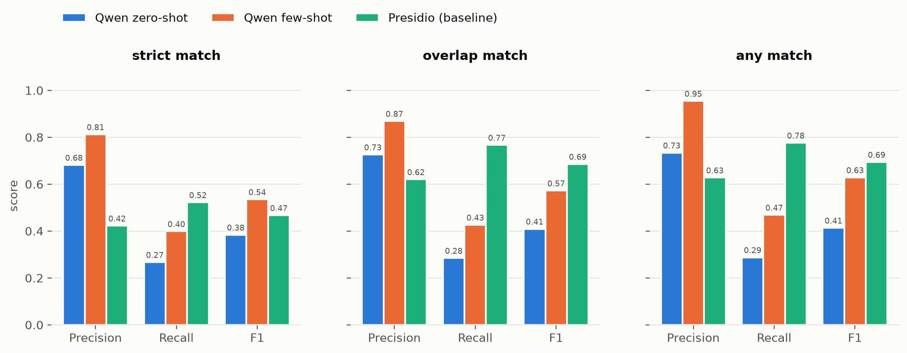
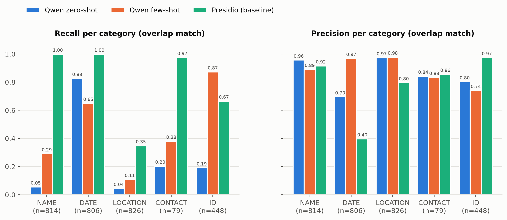
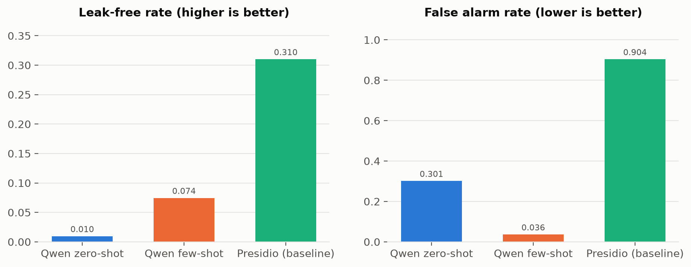
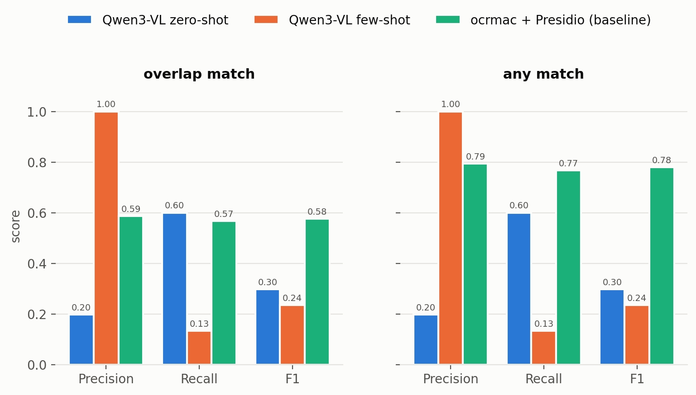
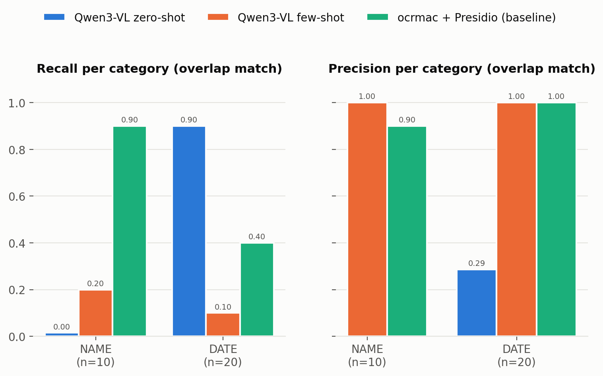
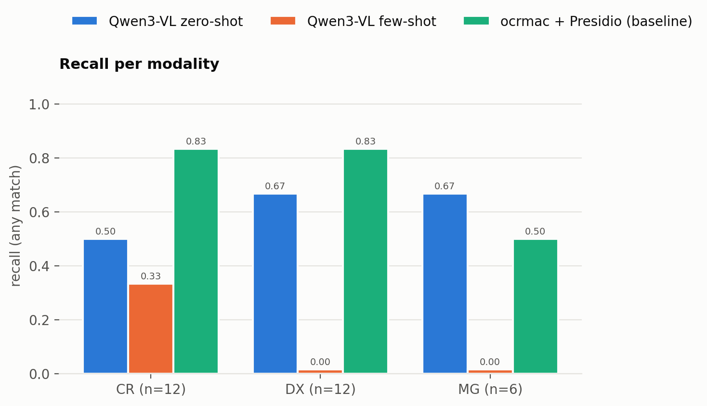
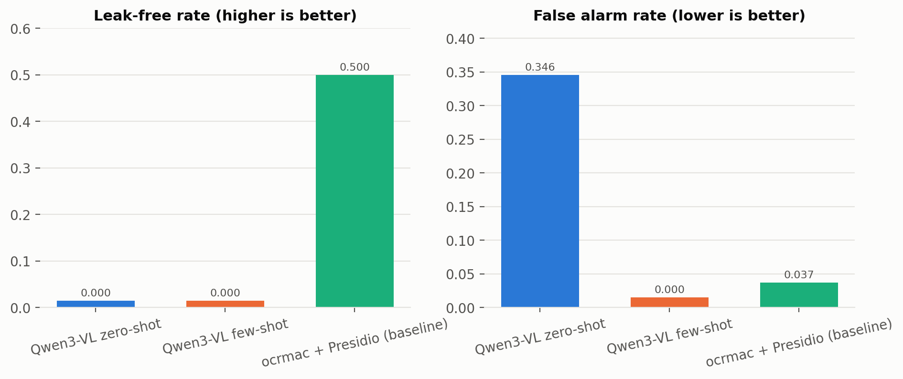
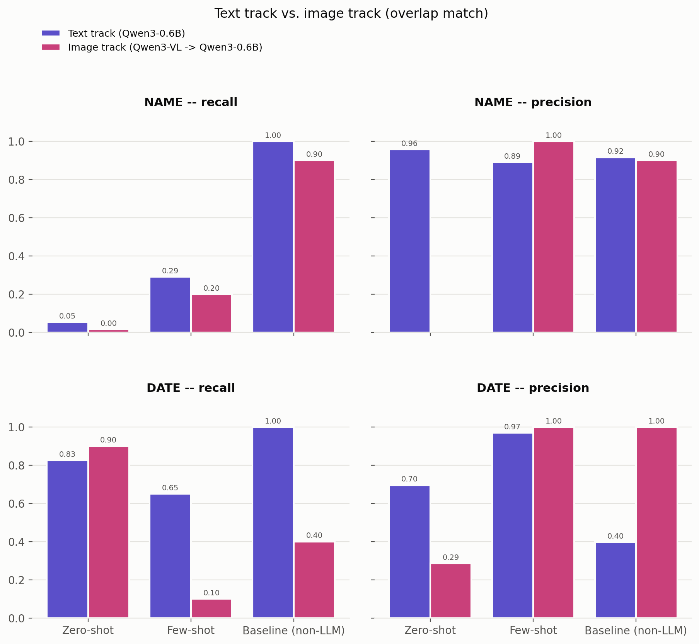

# Benchmarking LLMs and VLMs for Automated De-Identification of Clinical Text and Medical Images

Adnana Ivana, Jiatong Li

# Introduction

Protected health information (PHI), such as names, dates, addresses and ID numbers, appears both in clinical text and burned into the pixels of medical images. We study whether one model family (Qwen) can find and remove PHI in both modalities. The project has two tracks:

- **Text track** (Adnana Ivana): an LLM (Qwen3) finds PHI spans in synthetic clinical queries from ASQ-PHI.
- **Image track** (Jiatong Li): a VLM (Qwen3-VL) finds PHI in medical images from MIDI-B.

The task is information extraction, closely related to named entity recognition (NER): given a text, return every PHI span and its category. A missed PHI mention is a real privacy leak, so **recall is our primary metric**.

**Image track.** The image track asks the same question, but for pixels instead of text: can a model find PHI that has been burned directly into a medical image? Our approach is OCR-then-classify — a vision-language model (Qwen3-VL) reads out all the visible text in the image, and that transcript is then classified into the same five PHI categories as the text track, using the same scoring code. That way, if the two tracks end up with different results, we can be fairly confident it is because of the modality, not because we scored them differently.

# Data set

**Text track: ASQ-PHI.** The file `ASQ/synthetic_clinical_queries.txt` contains synthetic clinical questions. Each query comes with its PHI tags, and each tag has an `identifier_type` and the `value` as it appears in the text.

- 1051 queries, 2973 gold PHI spans
- 219 queries contain no PHI at all, which lets us measure over-redaction
- 13 ASQ PHI types. The most frequent are GEOGRAPHIC_LOCATION (826), NAME (814), DATE (806) and MEDICAL_RECORD_NUMBER (305). Several are very rare: ACCOUNT_NUMBER (4), FAX_NUMBER (2), CERTIFICATE_LICENSE_NUMBER (1) and IP_ADDRESS (1).

> **[Dataset source, construction and licence for ASQ-PHI: to be added.]**

**Shared taxonomy.** To compare the two tracks, both datasets are mapped onto five shared labels:

| shared label | ASQ-PHI types | gold spans |
|---|---|---|
| NAME | NAME | 814 |
| DATE | DATE | 806 |
| LOCATION | GEOGRAPHIC_LOCATION | 826 |
| CONTACT | phone, fax, email, IP address | 79 |
| ID | medical record, health plan, SSN, unique ID, account, certificate/licence | 448 |

The reviewers pointed out that a gap between the tracks might come from the datasets and not from the modality. The plan is to compare the tracks only on the shared categories that have enough support in *both* datasets.

**Image track: MIDI-B.** The image dataset is MIDI-B (Medical Image De-Identification Benchmark): real, already de-identified X-ray and mammography images from The Cancer Imaging Archive, with synthetic PHI burned back into them. It is licensed **CC BY 4.0** (DOI `10.7937/cf2p-aw56`), so no data use agreement or registration is needed.

The full release is large — 708 series across a validation and a test split, covering 8 imaging modalities — but we only need a slice of it. We use the **validation split**, and only the **CR, DX and MG modalities** (plain X-ray, digital X-ray, mammography), because those are the only modalities where MIDI-B's PHI generator actually writes text into the pixels; the rest get synthetic PHI in the DICOM header instead, which is no use for an OCR task. That leaves 76 series, 91 images, 2.3 GB — much smaller than the ~65 GB full release.

Of those 91 images, 35 have some kind of burned-in text redaction according to MIDI-B's own answer key. Most of them, though, are just technologist initials (e.g. "JT", "TJN") that MIDI-B does not treat as patient PHI. Only **10 images** actually carry a redaction that counts as patient PHI under our taxonomy — a small positive set, but a real one. The other 81 are true negatives, which is useful for checking how often a model cries wolf.

| shared label | MIDI-B categories | gold rows (this subset) |
|---|---|---|
| NAME | patient_name | 10 |
| DATE | date, patient_birth_date | 20 |
| LOCATION | *(none present)* | 0 |
| CONTACT | *(none present)* | 0 |
| ID | *(none present)* | 0 |

`patient_sex` does not map onto any of our five shared labels, so it is dropped from scoring. In practice, only NAME and DATE show up at all in this subset — no location, contact info or ID ever appears burned into these images — which is why the cross-modality comparison later on only looks at those two categories.

# Preprocessing

ASQ-PHI gives the PHI values but not their positions in the text, so we compute character offsets ourselves:

- **Gold spans:** each tagged value is located in its query by string search, and standalone matches (not inside a longer word) are preferred. Curly quotes are normalised. All gold values were found. One of them (`asq_0149`, "Children's Clinic") matched only after quote normalisation.
- **Model output:** the LLM returns span strings, not offsets. Each string is aligned to the text with an exact match first and a normalised fuzzy match as a fallback. Strings that cannot be found are marked *ungrounded* and count as false positives.

No other NLP preprocessing (tokenisation, lemmatisation, etc.) is applied. The models see the raw query.

**Image track.** Each DICOM is converted to a normal 8-bit PNG before it goes anywhere near the model: VOI LUT windowing is applied so it looks the way a radiologist would actually view it, MONOCHROME1 images are inverted, and for multi-frame scans (breast-tomosynthesis stacks) we only keep the first frame — none of those turned out to have any burned-in PHI anyway.

The ground truth comes from MIDI-B's answer-key database. TCIA only distributes this through IBM Aspera (no plain-HTTP download), so it was fetched once by hand. From its per-tag JSON we keep just the `pixels_hidden` entries — the burned-in text itself, its bounding box, font size and PHI category — for our 91 images; the full 2.8 GB database is not kept in the repository.

One subtlety carries over from the text track: a gold PHI string does not come with a fixed position of its own. It has to be located inside whatever OCR transcript is being scored, using the same exact-match-then-fuzzy-match logic as the text track. If the OCR genuinely missed a piece of text, the gold span simply cannot be found in the transcript — which correctly counts as a false negative rather than crashing the pipeline.

# Model training

No model is trained. We compare prompting conditions of a pretrained LLM against an existing non-LLM tool.

**LLM (Qwen3).** The current results are from **Qwen3-0.6B**, a small model used to test the pipeline. The proposal plans **Qwen3-8B**, and those runs are still to come. Setup:

- non-thinking mode and greedy decoding
- **constrained JSON decoding** (`outlines` with a Pydantic schema), so every output is a valid list of `{type, text}` spans using the five shared labels
- two conditions:
  - **zero-shot:** instructions only
  - **few-shot:** the same instructions plus 3 hand-written examples (easy, tricky, and a hard negative with no PHI). The examples are not taken from ASQ-PHI, so no test data leaks into the prompt.
- A third condition with Qwen3's "thinking" mode is planned but **has not been run yet**.

**Non-LLM baseline: Microsoft Presidio.** The reviewers asked for a reference point beyond zero-shot vs few-shot. Presidio (`presidio-analyzer`) is an existing PII detector that combines spaCy NER (`en_core_web_lg`) with rule-based recognizers. It runs with default settings and no score threshold. Its entity types are mapped onto the shared labels (e.g. PERSON → NAME, DATE_TIME → DATE, PHONE_NUMBER/EMAIL_ADDRESS/IP_ADDRESS → CONTACT, US_SSN/MEDICAL_LICENSE/… → ID).

All three conditions write the same prediction format and are scored by the same code.

**Image track: Qwen3-VL.** As planned in the proposal, the pipeline has two stages:

1. **OCR.** `Qwen3-VL-2B-Instruct` — the smallest Qwen3-VL model, matching how the text track uses Qwen3-0.6B for local runs — reads out every piece of visible text in an image and returns it as a transcript. It runs on CPU rather than GPU, since its vision encoder is not compatible with Apple's MPS backend on this machine; images are also downsized before being passed in, which keeps inference time manageable without hurting OCR quality.
2. **Classify.** That transcript then goes through the exact same classifier as the text track: the same `Qwen3-0.6B` model, the same prompt and schema, the same few-shot examples, and the same **zero-shot**/**few-shot** conditions. Keeping this step identical means any difference between tracks should come from the modality, not from using a different classifier.

**Baseline.** As a non-LLM point of comparison, `ocrmac` (macOS's built-in OCR) reads the image, and the same Presidio classifier the text track uses runs on the result.

We did not run a thinking-mode condition for the image track.

# Evaluation

**Metrics.** Each predicted span is compared with the gold spans of the same query in three modes:

| mode | a prediction counts as correct if… |
|---|---|
| strict | same start, end and label |
| overlap | the characters overlap and the label is the same |
| any | the characters overlap, label ignored. This is the privacy view: *would this PHI have been redacted?* |

We report micro-averaged precision, recall and F1, overall, per shared category and per ASQ type. At the query level we report:

- **leak-free rate:** the share of queries with PHI where every gold span was caught (any mode)
- **false-alarm rate:** the share of queries *without* PHI where something was still flagged

Results below are for all 1051 queries.

**Overall.** In overlap mode, the scores are:

| condition | precision | recall | F1 |
|---|---|---|---|
| Qwen3-0.6B zero-shot | 0.726 | 0.285 | 0.409 |
| Qwen3-0.6B few-shot | 0.869 | 0.427 | 0.573 |
| Presidio | 0.620 | **0.767** | **0.686** |

- **Few-shot examples help the small LLM a lot.** Recall rises from 0.29 to 0.43 and precision from 0.73 to 0.87. The share of ungrounded spans (strings not found in the query) drops from 23.1% to 1.3%.
- **Presidio has much higher recall than Qwen3-0.6B** (0.77 vs 0.43) but lower precision. With recall as the main metric, the baseline currently wins.

**Per category.**

- **Presidio** finds almost all names, dates and contact details (recall 1.00, 1.00 and 0.97). Its DATE precision is only 0.40, because it also tags ages ("60-year-old") and years on their own ("2023"), which ASQ-PHI does not annotate as PHI.
- **Few-shot Qwen is better on IDs** (recall 0.87 vs 0.67 for Presidio). This holds for medical record numbers in particular (any mode: 0.92 vs 0.70) and social security numbers (0.67 vs 0.36).
- **LOCATION is hard for every condition** (recall 0.04 / 0.11 / 0.35), and it is the largest category (826 spans).
- **The few-shot LLM is weak on names** (recall 0.29), and zero-shot even more so (0.05).
- Zero-shot DATE recall (0.83) is higher than few-shot (0.65). The few-shot examples do not help every category.

**Query level.**

- No condition fully de-identifies most queries. The leak-free rate is 0.010 for zero-shot, 0.074 for few-shot and 0.310 for Presidio.
- Presidio over-redacts heavily: it flags something in 90% of the queries that contain no PHI. For few-shot Qwen this is 3.7%.

**Main outcome so far.** The small Qwen3-0.6B model is precise but misses most PHI. An off-the-shelf tool (Presidio) catches much more, at the cost of many false alarms. Few-shot prompting clearly improves the LLM. Whether a larger model (Qwen3-8B) closes the recall gap is still open.

More figures (e.g. recall per ASQ type) are in `results/figures/`, and all numbers are in `results/*.csv`.

**Image track: results on MIDI-B.** These results cover all 91 images — 10 with PHI, 81 without.

**Overall.** In overlap mode:

| condition | precision | recall | F1 |
|---|---|---|---|
| Qwen3-VL zero-shot | 0.198 | 0.600 | 0.298 |
| Qwen3-VL few-shot | **1.000** | 0.133 | 0.235 |
| ocrmac + Presidio | 0.586 | 0.567 | **0.576** |

Unlike on the text track, the non-LLM baseline wins outright here — not just on recall, but on every metric. Zero-shot does find a reasonable share of the PHI, but at a real cost in precision: it only predicted anything at all on 37 of the 91 images, and a lot of those predictions are hallucinations (24 of them labelled `ID`, usually triggered by things like "PORTABLE #6"). Few-shot goes the other way: it is perfectly precise (1.0), but it barely does anything — it produces a prediction on only **2 of the 91 images**. Our best guess is that reusing the text track's few-shot examples verbatim, for comparability, backfires here: those examples are full clinical sentences, and a short, multi-line OCR transcript does not look anything like them, so the model seems to decide there is nothing to extract.

**Per category.** Only NAME and DATE have any gold examples in this subset.

The most striking result here: zero-shot never predicts NAME, not even once, across all 91 images — even though it reliably finds dates (recall 0.90). That is not an occasional miss, it is a complete blind spot. The baseline is the only condition that does reasonably well on both categories (NAME 0.90, DATE 0.40). Few-shot's recall on both categories is close to zero, which fits with it barely firing at all.

**Per modality.** With only 10 positive images split across CR, DX and MG (4/4/2), this is more of a rough picture than a precise estimate, but few-shot recalls none of the DX or MG cases.

**Image-level privacy metrics.**

| condition | leak-free rate | false-alarm rate |
|---|---|---|
| Qwen3-VL zero-shot | 0.000 | 0.346 |
| Qwen3-VL few-shot | 0.000 | 0.000 |
| ocrmac + Presidio | **0.500** | 0.037 |

Neither LLM condition ever fully de-identifies a PHI-bearing image. The baseline manages it for half of them, with a low false-alarm rate on top.

**Comparing the two tracks.** This is really the question the project is built around: does a model miss more PHI when it is hidden in pixels instead of written out as text? We compare the two tracks on NAME and DATE, the only categories with real examples on both sides, using the same taxonomy and scoring code — so any gap we see should be about the modality, not about how we measured it. One caveat: the two tracks do not run the same model end to end. The text track hands `Qwen3-0.6B` raw text and asks it to find PHI directly; the image track has `Qwen3-VL` turn the image into a transcript first, then hands that transcript to the same `Qwen3-0.6B` prompt. So "zero-shot" and "few-shot" below describe the shared classification step, not one model doing the whole job on both sides.

A couple of things stand out. Zero-shot's NAME recall is close to zero on both text (0.05) and images (0.00) — this looks like a weakness of zero-shot Qwen3 itself, not something specific to images. Few-shot's DATE recall, on the other hand, holds up fine on text (0.65) but falls apart on images (0.10) — this is the clearest modality-specific effect we found, and it fits the under-triggering problem above: the few-shot examples are already a stretch for ASQ-PHI's style, and even more of a stretch for a terse OCR transcript. The baseline also does noticeably worse on image dates (0.40) than text dates (1.00), probably because a burned-in format like "DOB: 11.12.1937" is less regular than a written-out date like "June 3rd, 2023".

One more thing worth flagging: for zero-shot, the overall `any`-mode and `overlap`-mode numbers come out identical, which might look like the matching mode does not matter here. It is actually a coincidence of how MIDI-B bundles PHI into one annotation box: under `any` mode, zero-shot's NAME recall jumps to 0.90, but that is not because it suddenly recognises names — its date predictions just happen to sit inside the same box as the name and get credited for it once the label requirement is dropped. The `overlap`-mode numbers above are the ones that actually reflect whether the model gets the category right.

**Main takeaway.** With only 10 positive images, these numbers move in big steps and should not be read too precisely — but the pattern is clear, and it mirrors the text track: the plain non-LLM tool beats both LLM conditions, and here the gap is even wider, because zero-shot has a hard blind spot for names and few-shot barely engages with OCR-style text at all.

# Future work

- Run the planned **Qwen3-8B** model and the **thinking** condition on the full dataset.
- Look at the remaining errors more closely, especially missed locations and names, and the boundary and label mistakes.
- Make the comparison with Presidio fairer, e.g. by testing a score threshold or excluding ages and bare years. Its default settings trade precision for recall.
- Complete the cross-modality comparison with the image track on the shared categories.

**Image track.**

- Try the MIDI-B **test split** as well, and a bigger Qwen3-VL model, to see whether the NAME blind spot and the few-shot under-triggering are about model size or just a prompt mismatch.
- Write few-shot examples that actually look like OCR transcripts, instead of reusing the text track's clinical-sentence examples — under-triggering on short, fragmented text is now a known failure mode.
- Try asking Qwen3-VL to localise and classify PHI directly in a single prompt, instead of splitting OCR and classification into two stages, and see if that does any better.
- Get more than 10 positive images to work with, either from the MIDI-B test split or by relaxing the CR/DX/MG restriction, so the per-category numbers stand on firmer ground.
